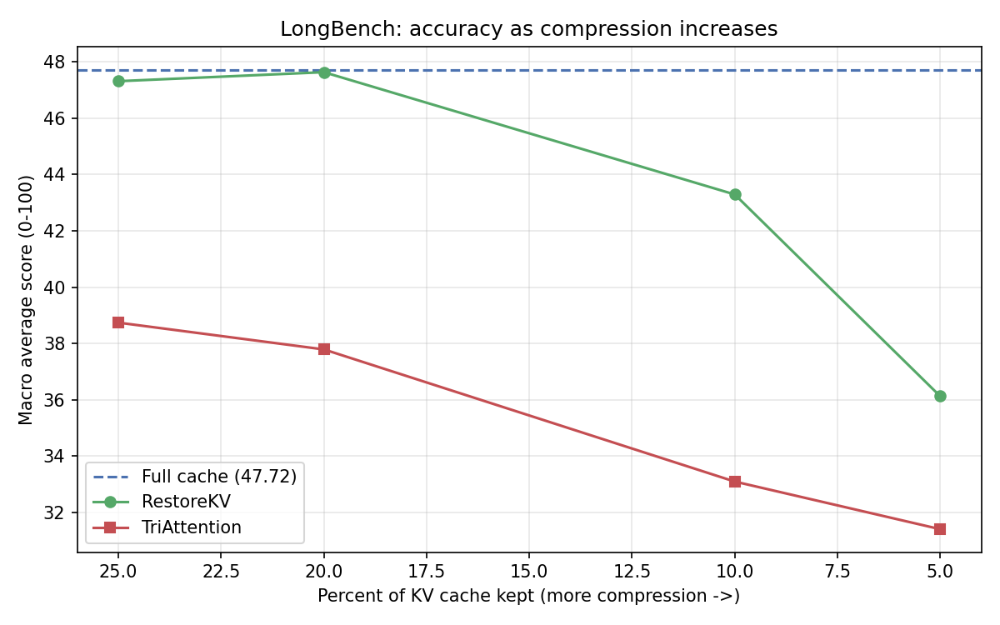
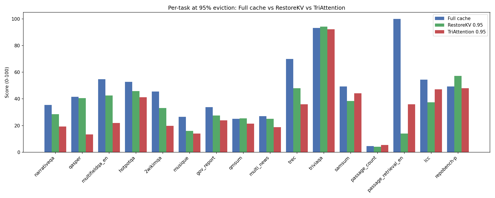
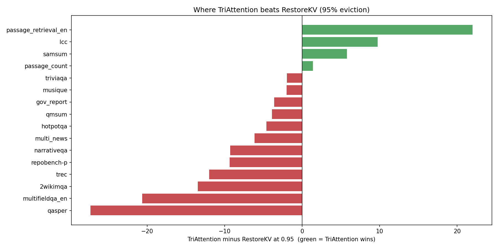

# TriAttention vs Full Cache vs RestoreKV on LongBench

A head-to-head comparison of three KV cache approaches on the same benchmark, same model, same 800
documents, same four compression ratios. All numbers are measured, not estimated.

| | |
|---|---|
| Model | Llama-3.1-8B-Instruct (bf16) |
| Benchmark | LongBench v1, 16 tasks, 800 documents |
| Methods compared | Full cache (no compression), RestoreKV, TriAttention |
| Ratios | 0.75, 0.80, 0.90, 0.95 (keep 25%, 20%, 10%, 5%) |
| Score | macro average over 16 tasks, higher is better |

---

## 1. Overall accuracy

How the macro average score changes as compression gets more aggressive.

| Keep | Full cache | RestoreKV | TriAttention |
|:---:|:---:|:---:|:---:|
| 100% | 47.7 | — | — |
| 25% (0.75) | — | 47.3 | 38.7 |
| 20% (0.80) | — | 47.6 | 37.8 |
| 10% (0.90) | — | 43.3 | 33.1 |
| 5% (0.95) | — | 36.1 | 31.4 |

**Honest read:** on the overall average, **RestoreKV is stronger than TriAttention at every ratio**.
RestoreKV stays very close to the full cache until heavy compression (it barely drops at 0.75 and
0.80), while TriAttention drops sooner. So if the goal is simply the highest average score at a given
budget, RestoreKV wins the headline number.

But the average hides something important: the two methods are good at different tasks. That is where
TriAttention earns its place.

---

## 2. Task by task at the hardest setting (keep only 5%)

The same data as the difference between the two compression methods. Green bars are tasks where
**TriAttention beats RestoreKV**; red bars are where RestoreKV wins.

---

## 3. Where TriAttention is the best

At 95% eviction, TriAttention clearly beats both the naive-pattern eviction of RestoreKV on several
specific task types:

| Task | Full cache | RestoreKV 0.95 | TriAttention 0.95 | TriAttention advantage |
|:---|:---:|:---:|:---:|:---:|
| passage_retrieval_en | 100.0 | 14.0 | 36.0 | +22.0 over RestoreKV |
| lcc (code) | 54.5 | 37.5 | 47.2 | +9.7 over RestoreKV |
| samsum (dialogue summary) | 49.3 | 38.5 | 44.3 | +5.8 over RestoreKV |
| passage_count | 4.5 | 4.0 | 5.4 | +1.4, also beats full cache |

**What these tasks have in common:** they need evidence spread across the whole document, or a pattern
that shows up in many places (finding a passage by position, completing code from earlier context,
summarizing a dialogue). TriAttention keeps words by a stable importance score learned from the model's
own attention geometry, so it holds onto this kind of broadly-distributed signal better than
attention-pattern eviction does, even when throwing away 95% of the cache.

The standout is **passage_retrieval_en**: at 95% eviction RestoreKV collapses to 14.0 while TriAttention
keeps 36.0, more than twice as good. On **passage_count** TriAttention (5.4) even edges out the full
cache (4.5).

---

## 4. Where TriAttention is not the best

Being honest about the full picture: TriAttention loses to RestoreKV on the question-answering tasks,
and by a lot on some.

| Task | RestoreKV 0.95 | TriAttention 0.95 | Gap |
|:---|:---:|:---:|:---:|
| qasper | 40.6 | 13.3 | RestoreKV +27.3 |
| multifieldqa_en | 42.5 | 21.8 | RestoreKV +20.7 |
| 2wikimqa | 33.2 | 19.7 | RestoreKV +13.5 |
| trec | 48.0 | 36.0 | RestoreKV +12.0 |

**Why:** these tasks hinge on a few exact sentences hidden in the document. RestoreKV keeps the words
the recent query actually attended to (so it tends to hold the answer sentence), while TriAttention
scores words by a general importance rule that is not tied to the specific question, so it sometimes
drops the exact sentence that held the answer.

---

## 5. Summary

| Question | Answer |
|:---|:---|
| Best overall average score? | RestoreKV |
| Best on passage retrieval, code, dialogue summary? | TriAttention |
| Best on pinpoint question-answering? | RestoreKV |
| Best memory savings (same idea, both evict tokens)? | comparable; both reach ~5% cache |

**Bottom line.** RestoreKV gives the higher average and is the safer general choice, especially for
question-answering. **TriAttention is the better choice when the task needs information spread across
the whole document**, such as passage retrieval (where it more than doubles RestoreKV at 95% eviction),
code completion, and dialogue summarization. TriAttention is not a universal winner, but it has a clear
and useful strength zone.

---

## Notes

- All three were run on the same 800 LongBench documents with the same model and scoring.
- TriAttention was run in WSL2 with FlashAttention so that long (up to 32K token) documents fit in GPU
  memory; see `README.md` for that story.
- Source numbers: `results/longbench/` (naive), `results/restorekv/longbench/` (RestoreKV),
  `results/triattention/longbench/` (TriAttention).
