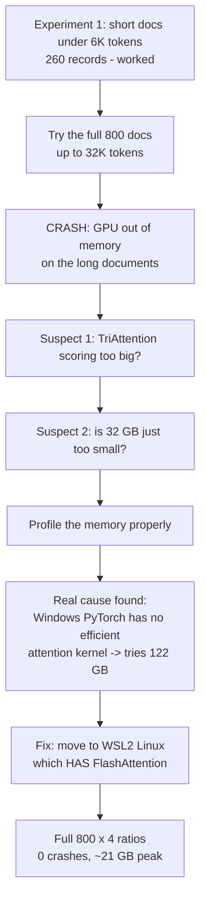

# TriAttention on LongBench — The Full Story

This is a complete, plain-language writeup of everything I did to test the **TriAttention**
KV-cache compression method on the **LongBench** benchmark with **Llama-3.1-8B-Instruct**. It covers
what the method is, the results, the big GPU out-of-memory (OOM) problem I hit, *why* it happened, and
how I finally fixed it. It is written so anyone can follow it, even without a deep ML background.

- Method: TriAttention (Mao et al., ICML 2026, [arXiv:2604.04921](https://arxiv.org/abs/2604.04921);
  repo [WeianMao/triattention](https://github.com/WeianMao/triattention))
- Model: Llama-3.1-8B-Instruct, bf16
- Benchmark: LongBench v1, all 16 English tasks, 800 test documents
- GPU: NVIDIA RTX 5090 (32 GB)

---

## Part 1 — The basics (what problem are we even solving?)

When a language model reads a document, it remembers every word it has seen by storing two numbers
(a "key" and a "value") for each word. This memory is called the **KV cache**. The longer the
document, the bigger the cache, and the more **GPU memory** it eats. On very long documents the cache
becomes a real burden.

**KV-cache compression** methods shrink this memory. The question they all face is a trade:

> How much memory can you save before the model's answers start getting worse?

My job was to measure that trade for one specific method: **TriAttention**.

### How TriAttention decides what to throw away

Most methods keep the words that recent words "paid attention to." TriAttention does something
cleverer: it learns, once and ahead of time, the typical "direction" each attention head looks in
(these are called **calibrated statistics**), and then keeps the words most likely to matter for
future questions. It always keeps the most recent words and the first few "anchor" words. Everything
else can be dropped according to a **compression ratio**:

| Ratio | Meaning |
|---|---|
| 0.75 | throw away 75%, keep 25% of the cache |
| 0.80 | throw away 80%, keep 20% |
| 0.90 | throw away 90%, keep 10% |
| 0.95 | throw away 95%, keep 5% |

---

## Part 2 — The final results (the good news first)

After the whole journey below, I ran **all 800 documents at all 4 compression ratios** cleanly, with
**zero crashes**. Here is the headline trade-off, measured against the full (uncompressed) cache:


| Setting | Quality (0-100) | KV cache size | Accuracy kept | Memory saved |
|---|---|---|---|---|
| Full cache (baseline) | 47.72 | 1.357 GB | 100% | 0% |
| TriAttention @0.75 (keep 25%) | 38.74 | 0.355 GB | 81% | 74% |
| TriAttention @0.80 (keep 20%) | 37.79 | 0.288 GB | 79% | 79% |
| TriAttention @0.90 (keep 10%) | 33.10 | 0.154 GB | 69% | 89% |
| TriAttention @0.95 (keep 5%) | 31.41 | 0.087 GB | 66% | 94% |

**In one line:** TriAttention can shrink the KV cache by up to about **15×** (1.357 → 0.087 GB) while
keeping roughly two-thirds of the quality — and much more quality at gentler settings.

The memory saved vs accuracy kept, side by side:


---

## Part 3 — Where TriAttention is strong and where it breaks

Not every task reacts the same way. This chart shows, at the most aggressive setting (keep only 5%),
how much each task changed versus the full cache. Red = got worse, green = got better:


**What holds up well (barely drops):**
- **triviaqa** (trivia questions): 93.2 → 92.2, almost no loss even at 95% eviction.
- **samsum, repobench-p, lcc, qmsum** (dialogue summary, code, meeting summary): stay close.

**What breaks (drops a lot):**
- **passage_retrieval_en**: 100 → 36. It needs the whole document, so throwing most of it away hurts.
- **qasper, multifieldqa_en, 2wikimqa** (question answering): drop sharply.

**Why question-answering breaks (in simple terms):** a QA answer usually hinges on a few exact
sentences buried somewhere in a long document. TriAttention keeps words based on a general "this looks
important" score, not on the specific question being asked — so it sometimes throws away the exact
sentence that held the answer. Tasks whose information is spread across many words (summaries, code)
survive, because losing a few words barely matters.

Full per-task numbers at every ratio:


Watch the scores change as compression gets more aggressive (one frame per ratio):


---

## Part 4 — The journey, step by step (this is where it got hard)

Getting to those clean numbers was not straightforward. Here is the whole path.



### Experiment 1 — the short documents (this worked)

I first ran TriAttention only on the **shorter** LongBench documents (under 6,000 words-ish). All 260
of them ran fine. This produced the first version of the accuracy-vs-memory trade and the flaw analysis
(QA is the weak spot). So far, so good.

(I also fixed an early mistake here: my first version *guessed* TriAttention's calibrated statistics
instead of computing them properly. That guess made the method look worse than it really is — it even
reported one task collapsing when the real method actually does great on it. I replaced the guess with
the authors' real calibration procedure, so all numbers reflect TriAttention as designed.)

### The problem — trying all 800 documents

When I extended to the **full 800 documents**, which include some very long ones (up to **32,000
tokens**), the program kept **crashing with "out of memory."** On the hardest setting, about **half**
the documents failed. Failed documents score zero, which dragged the averages down to garbage. So I
could not get a clean full-dataset result.

### Suspect 1 — "maybe TriAttention's math is too memory-hungry"

TriAttention's scoring builds some large temporary tables. I rewrote the scoring to work in small
**chunks** — compute a little, save the result, throw away the scratch work, repeat — so it never
builds one giant table. I even proved the chunked version gives the **exact same numbers** as before
(difference: 0.000). This helped, but the longest documents **still crashed**. So the scoring was not
the main culprit.

### Suspect 2 — "maybe 32 GB is just too small"

The tempting conclusion was "the GPU is too small, buy a bigger one." But the numbers did not add up.
Keeping 25% of a 32K document is only about **1 GB** of cache. The model itself is 16 GB. That is ~17
GB total — nowhere near 32 GB. So "the kept cache is too big" could not explain a 38 GB crash. Time to
actually measure, not guess.

### The real cause — a missing "efficient attention" kernel

I profiled one 32K document carefully. The shocking result: **even with no compression at all**, the
model tried to grab **122 GB** of memory during the very first step (reading the document).

Here is why. To read a long document, the model compares every word with every other word. For 32,000
words that is 32,000 × 32,000 comparisons. Done naively, that table is **122 GB** — impossible on any
normal GPU. Modern GPUs avoid this with a smart shortcut called **FlashAttention** (and a cousin,
"memory-efficient attention") that never builds the full table. These shortcuts bring the same 32K
read down to about **21 GB**.

The problem: **my Windows PyTorch did not have the FlashAttention shortcut.** It literally said *"Torch
was not compiled with flash attention."* The backup shortcut existed but the model refused to use it.
So PyTorch fell back to the naive 122 GB method and crashed.


This also explained a mystery: my teammate's runs on the **lab Linux machine** processed the same 32K
documents at ~24 GB with zero crashes. Same GPU, same code — but her Linux PyTorch **had**
FlashAttention, and my Windows one did not. The whole difference was the software build, not the method
and not the GPU size.

So the real answer was not "A: a code bug" and not "B: a too-small GPU." It was **"C: the Windows
software was missing the efficient attention kernel."**

### The fix — WSL2 with FlashAttention

Instead of buying a bigger GPU (which would not have helped — the naive method needs 122 GB on *any*
card), I set up **WSL2** (a real Linux environment running inside Windows, using the same RTX 5090). In
WSL, I installed a PyTorch build that **has FlashAttention**.

I tested the worst-case 32K document again. It ran in **21 GB, single-shot, no crash** — exactly like
the lab machine. Problem solved, no bigger GPU, no changes to the TriAttention algorithm.

### The final run

With WSL + FlashAttention, I ran the real thing: **all 800 documents × all 4 compression ratios =
3,200 runs**, the normal single-shot way (no special chunking), exactly matching how the baseline was
run so the comparison is fair.

**Result: 3,200 / 3,200 completed. Zero out-of-memory crashes. Peak GPU ~21-24 GB.** Those are the
numbers in Part 2.

---

## Part 5 — What each thing I tried actually did

| Attempt | Idea | Did it fix the crash? |
|---|---|---|
| Faithful calibration | use the authors' real statistics, not a guess | fixed wrong *numbers*, not the crash |
| Chunked scoring | compute TriAttention's score in small pieces | helped, proven identical results, but not enough alone |
| Chunked prefill | feed the document in pieces | helped aggressive ratios, messy and not apples-to-apples |
| CPU offloading | keep the cache in normal RAM | worked for the baseline, slow, hard to compare fairly |
| **WSL2 + FlashAttention** | **use the efficient attention kernel** | **this is what actually fixed it** |

---

## Part 6 — The files in this folder

| File | What it does |
|---|---|
| `triattention_press.py` | TriAttention itself (scoring + which words to keep) |
| `calibrate_triattention.py` + `calibration/` | computes and stores the method's statistics |
| `build_dev_data.py` | prepares the 800 LongBench documents |
| `run_all.py` | runs all the compression ratios and then the analysis |
| `analyze_results.py` | turns raw results into the CSVs, charts and GIFs |
| `write_flaws.py` | writes `FLAWS.md` from the measured numbers |
| `results_out/` | all outputs: CSVs, charts, animations, run log |
| `RESULTS.md` | the results tables and figures |
| `FLAWS.md` | the measured weaknesses and why they happen |
| `experiments_archive/` | everything from the earlier experiments and the OOM investigation, preserved |

---

## Part 7 — How to reproduce (in WSL2 with FlashAttention)

```bash
# inside WSL2 Ubuntu, with a FlashAttention-capable PyTorch in ~/flashattn-env
cd /mnt/c/Users/samm/Documents/Samruddhi/298a-kv-cache-compression
HF_TOKEN=<your token> ~/flashattn-env/bin/python members/samruddhi/build_dev_data.py
HF_TOKEN=<your token> ~/flashattn-env/bin/python members/samruddhi/calibrate_triattention.py \
    --output members/samruddhi/calibration/llama31_8b_stats.pt
HF_TOKEN=<your token> ~/flashattn-env/bin/python members/samruddhi/run_all.py \
    --compression-ratios 0.75,0.8,0.9,0.95 --skip-baseline
```

- No `--max-prompt-tokens`: all 800 documents, including the 32K ones.
- No `--chunk-prefill`: normal single-shot prefill, same as the baseline — a fair comparison.
- The full-cache baseline (47.72) is the team's shared 800-record run.

---

## Part 8 — The one-sentence takeaway

TriAttention gives a strong memory-for-accuracy trade (up to ~15× smaller KV cache while keeping ~66%
of quality, and much more at gentler settings); its weak spot is pinpoint question-answering; and the
scary OOM crash turned out to be a missing Windows attention kernel, fixed cleanly by running in WSL2
with FlashAttention — not by changing the method or buying a bigger GPU.
