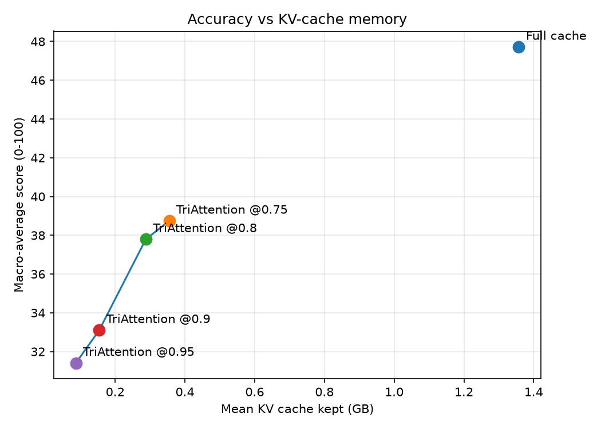
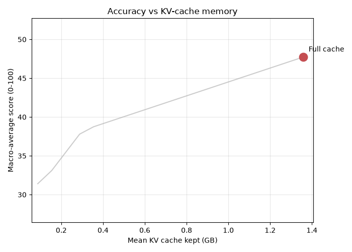
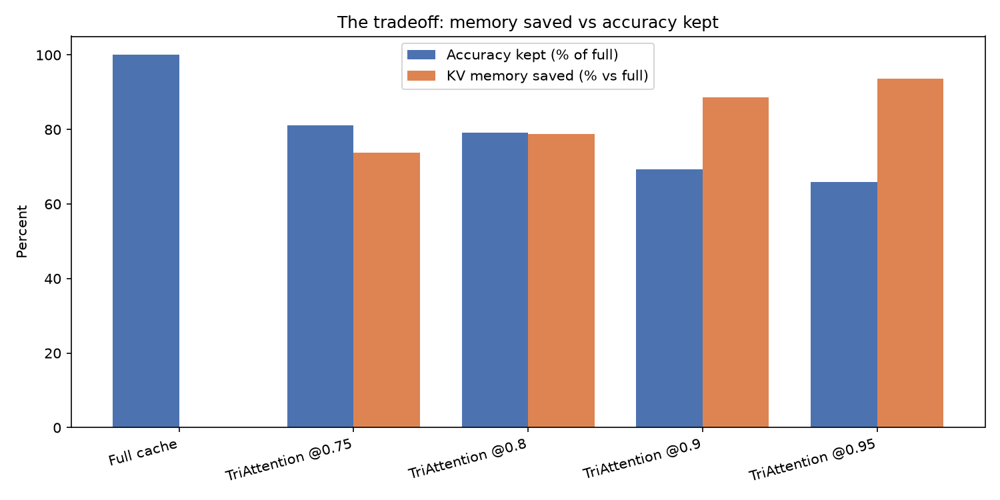
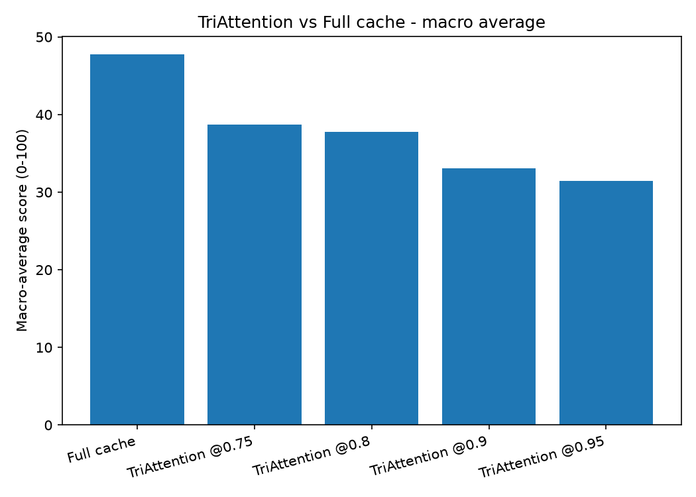
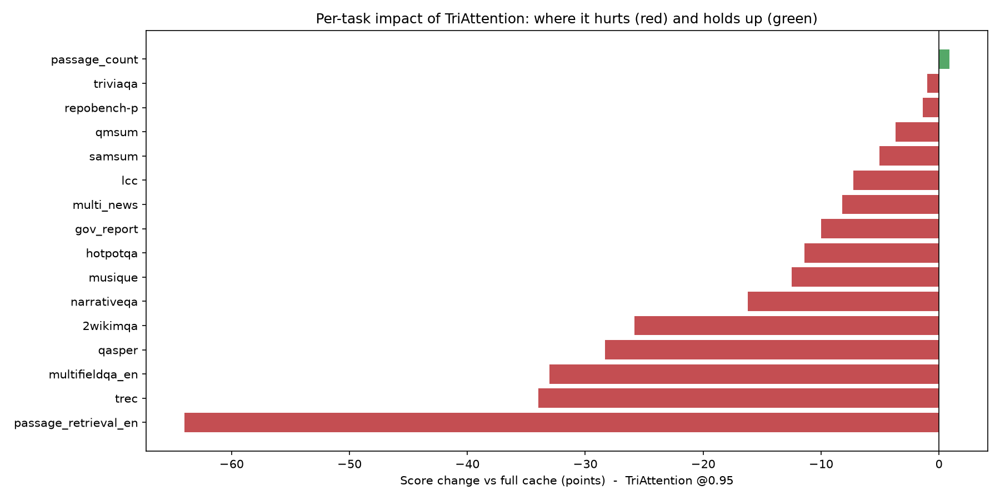
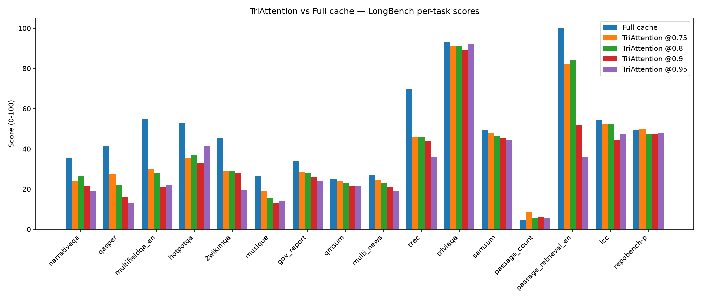
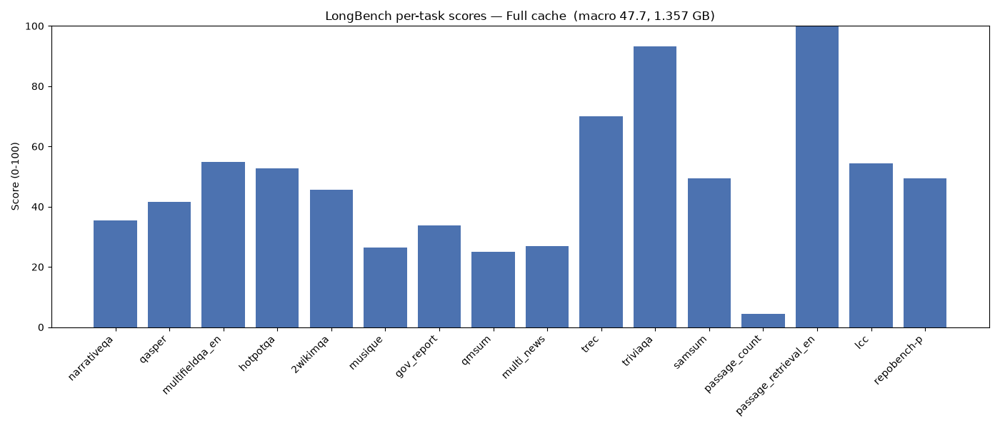
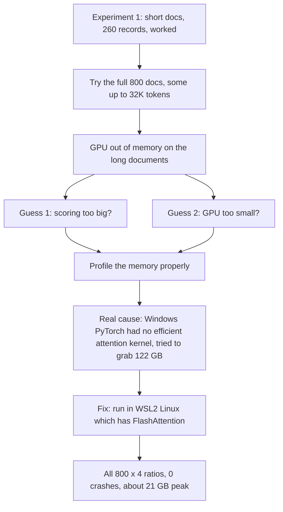
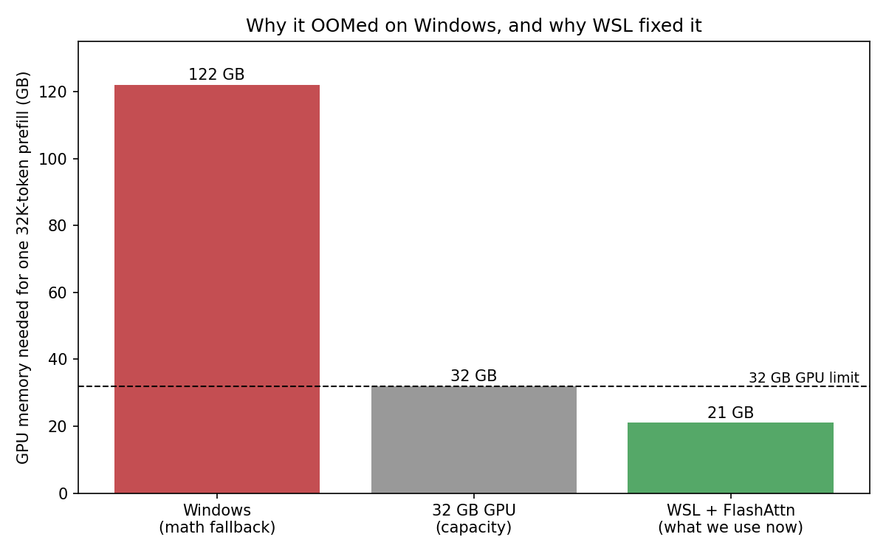

# TriAttention on LongBench

Testing the **TriAttention** KV cache compression method on **LongBench** with
**Llama-3.1-8B-Instruct**. The first half of this page is the clean results. The second half is the
full story of a GPU memory problem we hit and how we solved it.

| | |
|---|---|
| Method | TriAttention ([arXiv:2604.04921](https://arxiv.org/abs/2604.04921), [repo](https://github.com/WeianMao/triattention)) |
| Model | Llama-3.1-8B-Instruct (bf16) |
| Benchmark | LongBench v1, 16 tasks, 800 documents |
| GPU | NVIDIA RTX 5090 (32 GB) |
| Final run | all 800 documents at 4 compression ratios, 0 crashes |

---

# Part A: Results

## What the method does

When a model reads a document, it stores two numbers (a key and a value) for every word it sees. This
memory is the KV cache, and it grows with document length until it dominates GPU memory. TriAttention
shrinks the cache by keeping only the most useful words and dropping the rest. A compression ratio sets
how aggressively it drops:

| Ratio | Keeps | Drops |
|:---:|:---:|:---:|
| 0.75 | 25% | 75% |
| 0.80 | 20% | 80% |
| 0.90 | 10% | 90% |
| 0.95 | 5% | 95% |

## The numbers

All 800 documents, all four ratios, measured against the full uncompressed cache.

| Setting | Quality /100 | KV cache | Accuracy kept | Memory saved |
|:---|:---:|:---:|:---:|:---:|
| Full cache | 47.7 | 1.357 GB | 100% | — |
| TriAttention 0.75 | 38.7 | 0.355 GB | 81% | 74% |
| TriAttention 0.80 | 37.8 | 0.288 GB | 79% | 79% |
| TriAttention 0.90 | 33.1 | 0.154 GB | 69% | 89% |
| TriAttention 0.95 | 31.4 | 0.087 GB | 66% | 94% |

TriAttention shrinks the KV cache up to about 15x (1.357 GB to 0.087 GB) while keeping roughly two
thirds of the quality, and much more at gentler settings.

Accuracy versus KV cache memory:



The same trade as an animation, moving from full cache down to keeping 5%:



Memory saved versus accuracy kept, side by side:



Macro average score for each run:



## Where it is strong and where it struggles

At the most aggressive setting (keep only 5%), this chart shows how much each task changed versus the
full cache. Green means it held up, red means it got worse.



Holds up well:

| Task | Full cache | 0.95 | Change |
|:---|:---:|:---:|:---:|
| triviaqa | 93.2 | 92.2 | almost none |
| samsum | 49.3 | 44.3 | small |
| repobench-p (code) | 49.3 | 48.0 | small |

Struggles:

| Task | Full cache | 0.95 | Change |
|:---|:---:|:---:|:---:|
| passage_retrieval_en | 100.0 | 36.0 | large drop |
| qasper (QA) | 41.6 | 13.3 | large drop |
| multifieldqa_en (QA) | 54.9 | 21.8 | large drop |

A question-answering answer usually depends on a few exact sentences hidden in a long document.
TriAttention keeps words by a general importance score, not by the specific question, so it can drop
the one sentence that held the answer. Tasks whose meaning is spread across many words (summaries,
code) barely notice a few missing words.

Per-task scores at every ratio:



The same scores animated, one frame per ratio:



---

# Part B: The journey and the memory problem



**Step 1. Short documents worked.** We first ran only the shorter LongBench documents (260 of them).
They ran fine and gave the first accuracy versus memory picture. We also replaced an early shortcut
(guessing TriAttention's statistics) with the authors' real calibration, so every number reflects the
method as designed.

**Step 2. The full 800 kept crashing.** Adding the long documents (up to 32,000 tokens) caused constant
out-of-memory crashes. On the hardest setting about half the documents failed, and failed documents
score zero, which wrecked the averages.

**Step 3. Two wrong guesses.** First we suspected TriAttention's scoring. We rewrote it to work in small
chunks and proved the result was identical (difference 0.000). It helped but the long documents still
crashed. Then we suspected the 32 GB GPU was too small. The math said no: keeping 25% of a 32K document
is only about 1 GB of cache, and with the 16 GB model that is about 17 GB, nowhere near 32 GB. A 38 GB
crash made no sense, so we measured instead of guessing.

**Step 4. The real cause.** Profiling one 32K document showed that even with no compression at all, the
model tried to grab 122 GB at the very first step. To read a document the model compares every word
with every other word, which for 32,000 words is a 32,000 x 32,000 table, about 122 GB. Modern GPUs
avoid building that table using a shortcut called FlashAttention, which does the same work in about
21 GB. Our Windows PyTorch did not have FlashAttention, so it fell back to the 122 GB table and crashed.



This explained why a teammate's runs on the lab Linux machine read the same 32K documents at about
24 GB with no crashes. Same GPU, same code. The only difference was that Linux PyTorch had
FlashAttention and Windows did not. The crash was not a bug in TriAttention and not a too-small GPU. It
was a missing attention kernel in the Windows build.

**Step 5. The fix: WSL2 with FlashAttention.** Instead of buying a bigger GPU (which would not help,
since the 122 GB table overflows any card), we ran inside WSL2 (Linux inside Windows, same RTX 5090)
with a PyTorch build that has FlashAttention. The worst-case 32K document then ran in 21 GB, single
shot, no crash. We then ran all 800 documents at all 4 ratios, 3,200 runs total, with zero crashes and
a peak around 21 to 24 GB. Those are the numbers in Part A.

## What each attempt did

| Attempt | Idea | Fixed the crash? |
|:---|:---|:---|
| Faithful calibration | use the authors' real statistics | fixed the numbers, not the crash |
| Chunked scoring | compute the score in small pieces | helped, proven identical, not enough alone |
| Chunked prefill | feed the document in pieces | helped hard ratios, not a fair comparison |
| CPU offloading | keep the cache in normal RAM | worked but slow and hard to compare |
| WSL2 with FlashAttention | use the efficient attention kernel | yes, this fixed it |

---

# Part C: Reference

## Files in this folder

| Path | What it is |
|:---|:---|
| `triattention_press.py` | the method: scores words and keeps the best |
| `calibrate_triattention.py`, `calibration/` | computes and stores the method's statistics |
| `build_dev_data.py` | prepares the 800 LongBench documents |
| `run_all.py` | runs every ratio, then the analysis |
| `analyze_results.py` | builds the CSVs, charts and animations |
| `write_flaws.py` | writes `FLAWS.md` from the measured numbers |
| `results_out/` | all outputs: CSVs, charts, animations, log |
| `RESULTS.md`, `FLAWS.md` | result tables, and the measured weaknesses |
| `experiments_archive/` | everything from the earlier experiments and the OOM investigation |

Result files for the four ratios live at the repo level in `results/triattention/longbench/`, mirroring
`results/restorekv/`.

## How to reproduce (WSL2 with FlashAttention)

```bash
cd /mnt/c/Users/samm/Documents/Samruddhi/298a-kv-cache-compression
HF_TOKEN=<token> ~/flashattn-env/bin/python members/samruddhi/build_dev_data.py
HF_TOKEN=<token> ~/flashattn-env/bin/python members/samruddhi/calibrate_triattention.py \
    --output members/samruddhi/calibration/llama31_8b_stats.pt
HF_TOKEN=<token> ~/flashattn-env/bin/python members/samruddhi/run_all.py \
    --compression-ratios 0.75,0.8,0.9,0.95 --skip-baseline
```

No `--max-prompt-tokens` (all 800 documents) and no `--chunk-prefill` (normal single-shot prefill, the
same as the baseline, so the comparison is fair).

## Takeaway

TriAttention trades memory for accuracy well (up to about 15x smaller cache while keeping about two
thirds of quality, more at gentler settings). Its weak spot is pinpoint question-answering. The crash
was never about the method or the GPU size; it was a missing Windows attention kernel, fixed by moving
to WSL2 with FlashAttention.
