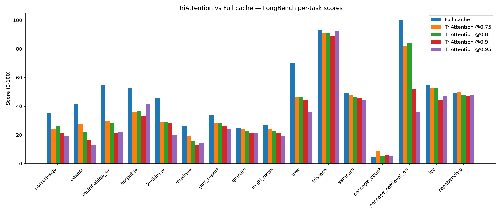
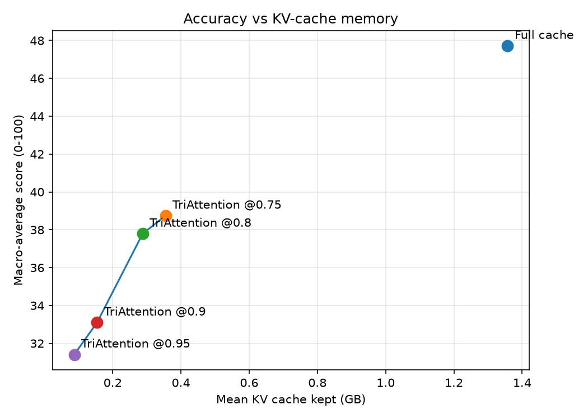
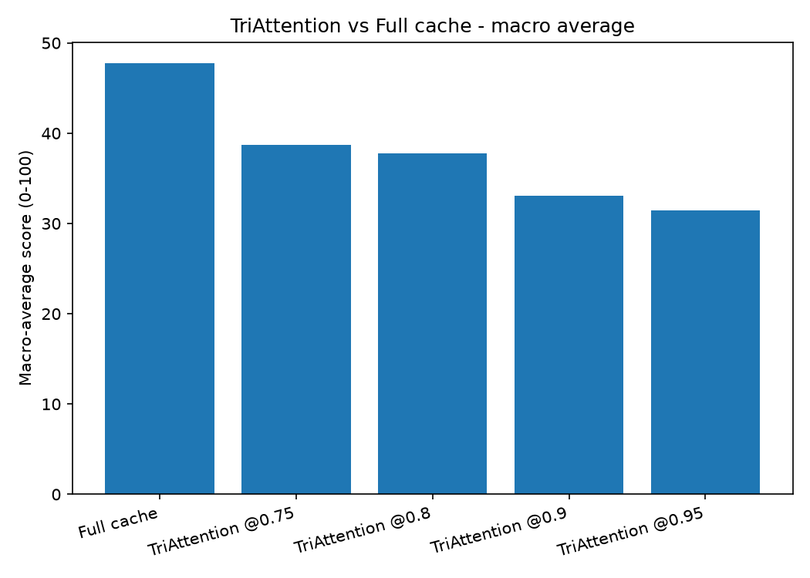

# TriAttention on LongBench - Results

**Method:** TriAttention (Mao et al., ICML 2026, [arXiv:2604.04921](https://arxiv.org/abs/2604.04921); repo [WeianMao/triattention](https://github.com/WeianMao/triattention))  
**Model:** meta-llama/Llama-3.1-8B-Instruct (bf16)  
**Benchmark:** LongBench v1 dev set, 16 tasks (800 records per run, prompts capped at 6K tokens).  
**Baseline:** full cache (no compression). This document covers TriAttention only.

## What TriAttention does

TriAttention scores each cached key with a frequency-domain trigonometric series built from **precomputed per-head query statistics** (the authors' calibration), then keeps the highest-scoring tokens plus a recent window and the initial sink tokens. It is implemented here as a kvpress `ScorerPress` (`members/samruddhi/triattention_press.py`) running the authors' exact scoring over stats from `calibrate_triattention.py`, so it goes through the shared harness with the same fair split and official metrics as the full-cache baseline.

## Runs

| Run | Records | Macro avg | Mean KV cache (GB) | Mean sec/record |
|---|---|---|---|---|
| Full cache | 800 | 47.72 | 1.3574 | 3.29 |
| TriAttention @0.75 | 800 | 38.74 | 0.3548 | 4.63 |
| TriAttention @0.8 | 800 | 37.79 | 0.2879 | 4.65 |
| TriAttention @0.9 | 800 | 33.10 | 0.1542 | 4.56 |
| TriAttention @0.95 | 800 | 31.41 | 0.0874 | 4.56 |

## Per-task scores (0-100)

| Task | Full cache | TriAttention @0.75 | TriAttention @0.8 | TriAttention @0.9 | TriAttention @0.95 |
|---|---|---|---|---|---|
| narrativeqa | 35.47 | 24.26 | 26.34 | 21.45 | 19.27 |
| qasper | 41.63 | 27.70 | 22.15 | 16.17 | 13.30 |
| multifieldqa_en | 54.85 | 29.83 | 28.05 | 21.11 | 21.83 |
| hotpotqa | 52.72 | 35.60 | 36.76 | 33.14 | 41.30 |
| 2wikimqa | 45.53 | 28.98 | 29.02 | 28.11 | 19.70 |
| musique | 26.50 | 18.89 | 15.43 | 12.93 | 14.00 |
| gov_report | 33.88 | 28.56 | 28.22 | 25.81 | 23.91 |
| qmsum | 25.06 | 23.90 | 22.89 | 21.31 | 21.40 |
| multi_news | 27.01 | 24.31 | 22.93 | 20.99 | 18.82 |
| trec | 70.00 | 46.00 | 46.00 | 44.00 | 36.00 |
| triviaqa | 93.20 | 91.20 | 91.20 | 89.20 | 92.20 |
| samsum | 49.31 | 48.06 | 46.20 | 45.40 | 44.25 |
| passage_count | 4.50 | 8.43 | 5.56 | 6.13 | 5.38 |
| passage_retrieval_en | 100.00 | 82.00 | 84.00 | 52.00 | 36.00 |
| lcc | 54.46 | 52.54 | 52.32 | 44.52 | 47.22 |
| repobench-p | 49.33 | 49.64 | 47.62 | 47.32 | 47.97 |
| **macro average** | 47.72 | 38.74 | 37.79 | 33.10 | 31.41 |

## Figures

## Data files

- `results_out/per_record.csv` — every record's task, score, latency, KV-cache size
- `results_out/per_task_summary.csv` — mean score per task per run
- `results_out/run_summary.csv` — macro average, mean KV cache, mean latency per run
- `results_out/run_log.txt` — full stdout/stderr of the harness runs
