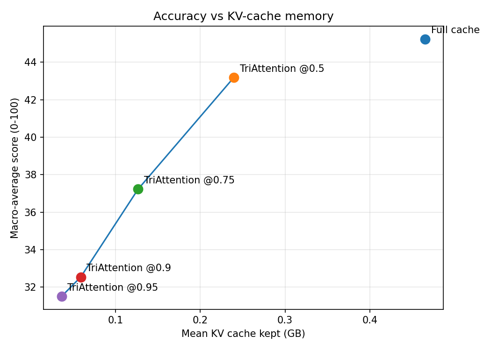

# TriAttention - Observed Flaws

Every point below is measured from our own LongBench runs on meta-llama/Llama-3.1-8B-Instruct, not taken from the paper. Source numbers are in `results_out/per_task_summary.csv` and `results_out/run_summary.csv`.

These flaws are attributable to TriAttention itself: the press runs the authors' scoring over per-head frequency statistics produced by their calibration (`calibrate_triattention.py` -> `calibration/llama31_8b_stats.pt`), not an approximation. An earlier online-estimate version both invented flaws that do not exist (e.g. it reported hotpotqa collapsing to 16.7 at @0.5, where the calibrated method actually scores 91.7) and exaggerated the real ones, so its flaws could not be trusted. The calibrated results below isolate the method's genuine weaknesses.

Baseline (full cache) macro average: **45.24**. Headline TriAttention run: **TriAttention @0.95** (macro **31.50**, mean KV cache **0.036 GB** vs **0.465 GB** full).

## 1. Accuracy cost at the target budget

At TriAttention @0.95, the macro average falls 13.73 points (30.4% relative) below the full cache. This is a large regression.

## 2. Tasks hurt the most

| Task | Category | Full cache | TriAttention @0.95 | Δ |
|---|---|---|---|---|
| multifieldqa_en | Single-Doc QA | 58.37 | 19.21 | -39.16 |
| 2wikimqa | Multi-Doc QA | 52.68 | 17.16 | -35.52 |
| qasper | Single-Doc QA | 40.88 | 16.83 | -24.05 |
| trec | Few-shot | 60.00 | 36.00 | -24.00 |
| gov_report | Summarization | 35.93 | 22.87 | -13.06 |

## 3. Which capabilities degrade

| Category | Mean Δ vs full cache |
|---|---|
| Single-Doc QA | -31.61 |
| Multi-Doc QA | -21.93 |
| Summarization | -8.79 |
| Code | -7.42 |
| Few-shot | -5.51 |

The **Single-Doc QA** tasks lose the most, which points to where TriAttention's pre-RoPE importance score discards information this model actually needed.

## 4. Degradation as the budget shrinks

| Run | Compression | Macro avg | Mean KV (GB) |
|---|---|---|---|
| TriAttention @0.5 | 0.5 | 43.19 | 0.240 |
| TriAttention @0.75 | 0.75 | 37.23 | 0.127 |
| TriAttention @0.9 | 0.9 | 32.54 | 0.059 |
| TriAttention @0.95 | 0.95 | 31.50 | 0.036 |

Accuracy drops more than 10 points below full cache once eviction reaches **0.9** (macro 32.54). Below that budget the method is no longer competitive with the full cache on this model.

## 5. Why QA degrades: the root cause to target

The tasks that collapse (Single-Doc and Multi-Doc QA) share a property: the answer depends on a few specific evidence tokens scattered through a long document. TriAttention's frequency-domain score ranks a key by how much attention it is expected to receive averaged over future query distances, using the calibrated query centres. That expectation is position/geometry-driven, not query-content-driven, so isolated evidence tokens that matter only for one specific question receive low scores and are evicted. Tasks with redundant or structurally regular signal (code completion, few-shot classification, summarization) survive because the information is spread across many tokens, so losing some is cheap. This points at the concrete lever for improvement: make the score sensitive to the actual question/evidence, not only the calibrated query geometry.

## 6. Measurement scope

Runs cover the LongBench dev prompts under 6K tokens (260 records per run, all 16 tasks). Longer prompts exceed the 32 GB GPU during the uncompressed prefill, so the longest-document examples are not included.
