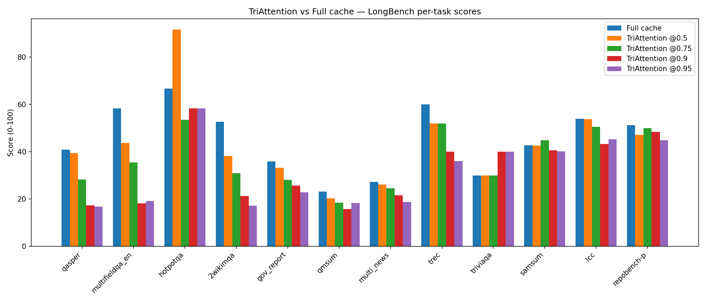
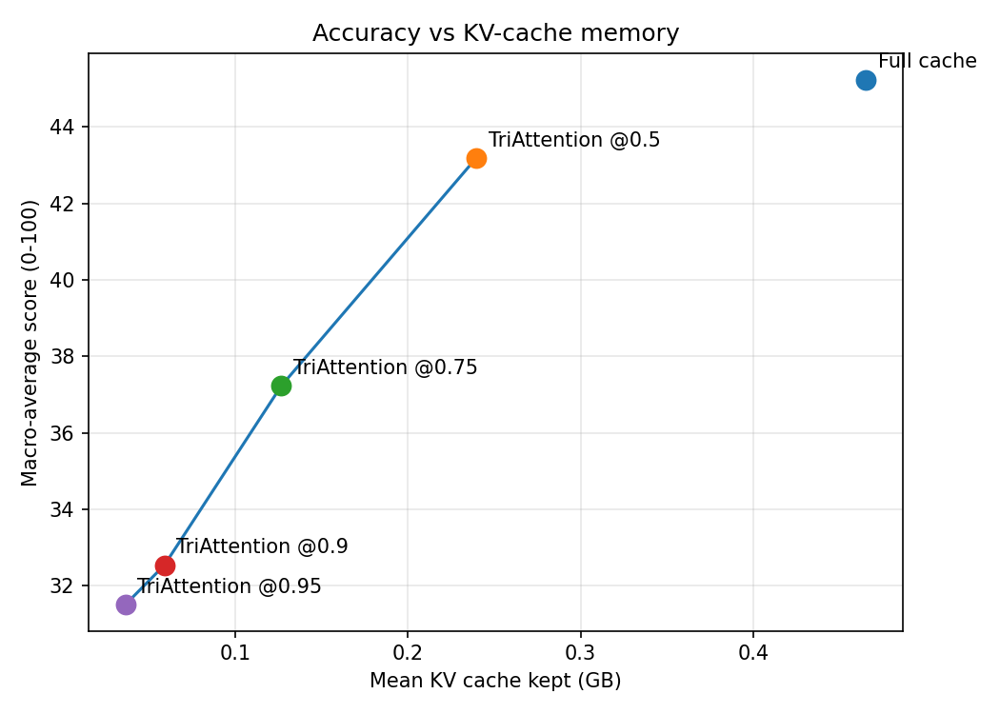
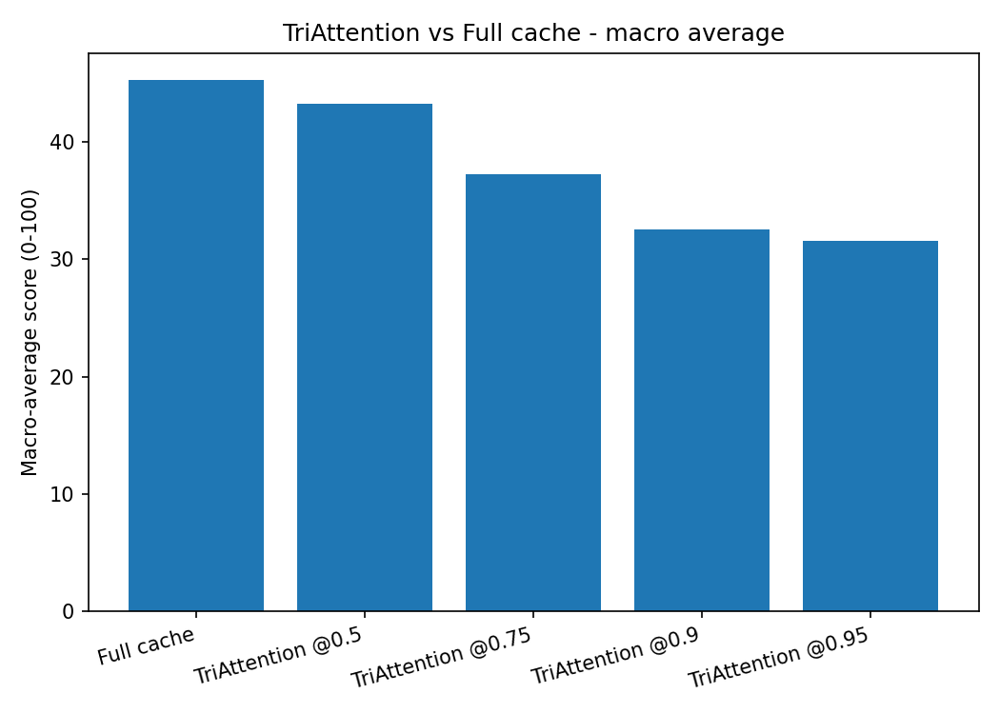

# TriAttention on LongBench - Results

**Method:** TriAttention (Mao et al., ICML 2026, [arXiv:2604.04921](https://arxiv.org/abs/2604.04921); repo [WeianMao/triattention](https://github.com/WeianMao/triattention))  
**Model:** meta-llama/Llama-3.1-8B-Instruct (bf16)  
**Benchmark:** LongBench v1 dev set, 16 tasks (260 records per run, prompts capped at 6K tokens).  
**Baseline:** full cache (no compression). This document covers TriAttention only.

## What TriAttention does

TriAttention scores each cached key with a frequency-domain trigonometric series built from **precomputed per-head query statistics** (the authors' calibration), then keeps the highest-scoring tokens plus a recent window and the initial sink tokens. It is implemented here as a kvpress `ScorerPress` (`members/samruddhi/triattention_press.py`) running the authors' exact scoring over stats from `calibrate_triattention.py`, so it goes through the shared harness with the same fair split and official metrics as the full-cache baseline.

## Runs

| Run | Records | Macro avg | Mean KV cache (GB) | Mean sec/record |
|---|---|---|---|---|
| Full cache | 260 | 45.24 | 0.4654 | 9.02 |
| TriAttention @0.5 | 260 | 43.18 | 0.2396 | 10.16 |
| TriAttention @0.75 | 260 | 37.23 | 0.1267 | 9.18 |
| TriAttention @0.9 | 260 | 32.54 | 0.0589 | 8.94 |
| TriAttention @0.95 | 260 | 31.50 | 0.0364 | 8.91 |

## Per-task scores (0-100)

| Task | Full cache | TriAttention @0.5 | TriAttention @0.75 | TriAttention @0.9 | TriAttention @0.95 |
|---|---|---|---|---|---|
| qasper | 40.88 | 39.45 | 28.19 | 17.38 | 16.83 |
| multifieldqa_en | 58.37 | 43.67 | 35.48 | 18.21 | 19.21 |
| hotpotqa | 66.67 | 91.67 | 53.57 | 58.33 | 58.33 |
| 2wikimqa | 52.68 | 38.23 | 30.98 | 21.33 | 17.16 |
| gov_report | 35.93 | 33.20 | 28.06 | 25.65 | 22.87 |
| qmsum | 23.19 | 20.27 | 18.50 | 15.69 | 18.36 |
| multi_news | 27.28 | 26.18 | 24.53 | 21.56 | 18.81 |
| trec | 60.00 | 52.00 | 52.00 | 40.00 | 36.00 |
| triviaqa | 30.00 | 30.00 | 30.00 | 40.00 | 40.00 |
| samsum | 42.78 | 42.62 | 44.91 | 40.57 | 40.24 |
| lcc | 53.91 | 53.77 | 50.48 | 43.33 | 45.36 |
| repobench-p | 51.19 | 47.18 | 50.02 | 48.38 | 44.89 |
| **macro average** | 45.24 | 43.18 | 37.23 | 32.54 | 31.50 |

## Figures

## Data files

- `results_out/per_record.csv` — every record's task, score, latency, KV-cache size
- `results_out/per_task_summary.csv` — mean score per task per run
- `results_out/run_summary.csv` — macro average, mean KV cache, mean latency per run
- `results_out/run_log.txt` — full stdout/stderr of the harness runs
