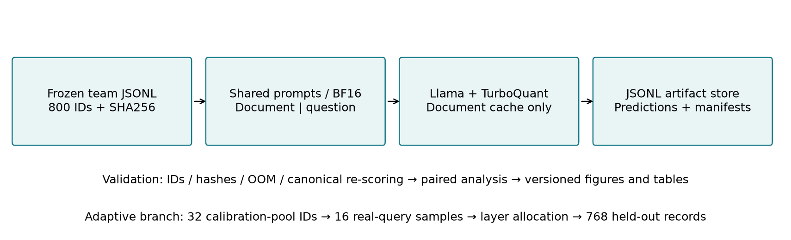
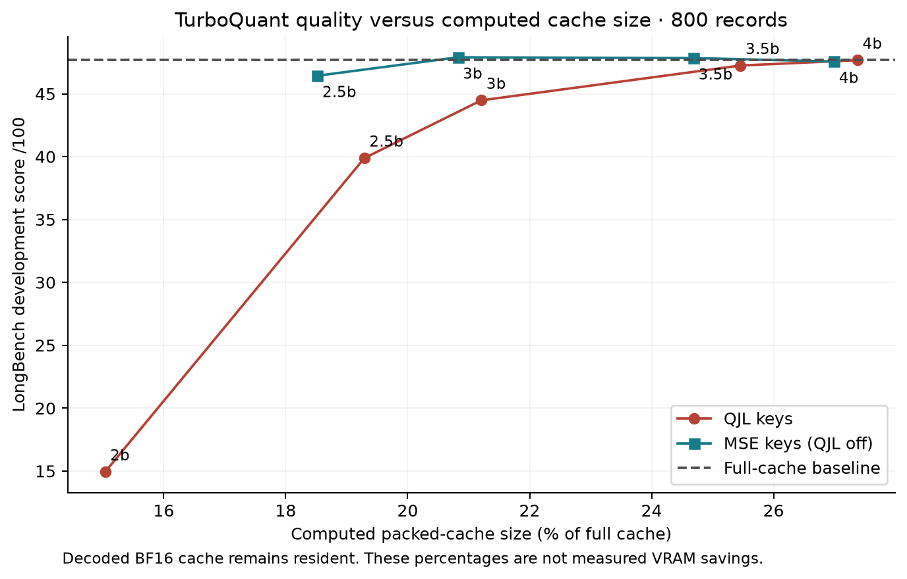
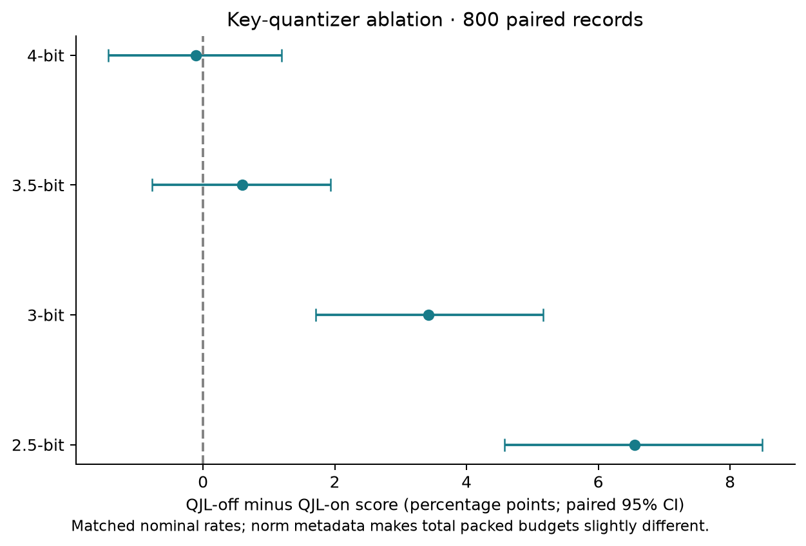
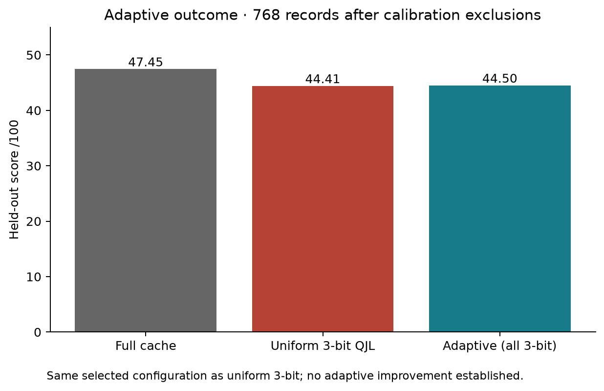
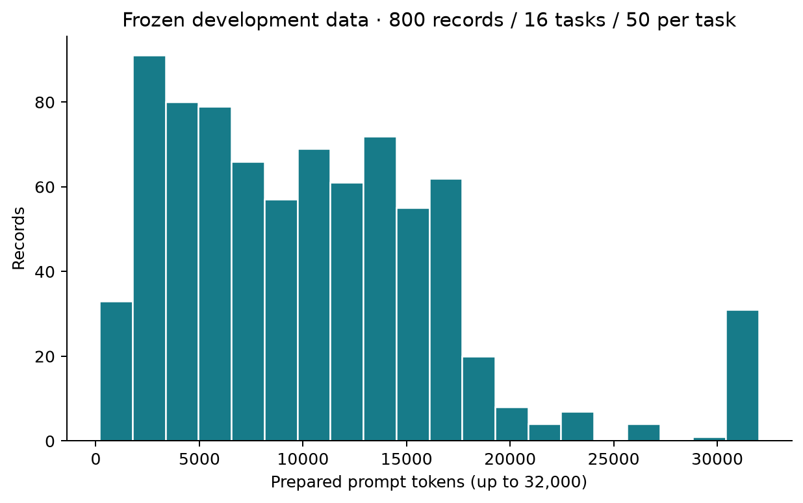

# Workbook 2 — Vedant's TurboQuant contribution

Use this material in the team's Workbook 2 template. This is the completed TurboQuant contribution and evidence, not a completed team workbook. Required submission filename from the supplied assignment is **T6.A6.docx**. The separate Workbook 2 template was not provided with this request, so this Markdown does not claim to reproduce its formatting.

## 4.1 Model proposal: concepts, architecture and project extension

The target problem is the growth of transformer key/value cache storage as document context grows. The common backbone is Llama-3.1-8B-Instruct. TurboQuant is a cache-compression method applied to that backbone, not a separately trained language model. The implementation rotates and scalar-quantizes vectors, packs low-bit codes, and stores scale metadata. Values use the MSE quantizer. Keys use either the product construction with a QJL residual bit or an MSE-only ablation.

Nine completed fixed configurations evaluate QJL keys at nominal 2, 2.5, 3, 3.5 and 4 bits, and MSE keys at 2.5, 3, 3.5 and 4 bits. These are configurations of one method; do not count them as nine independent models to meet the rubric's five-model requirement. The team must describe its distinct method families separately.

The mixed-channel implementation ranks document-only channel energy per head and gives half the original channels the higher bit rate, using independent subgroup quantizers. This is the project's explicit allocation interpretation, not an exact reproduction of an underspecified paper recipe. The shared team protocol keeps question and generated tokens at BF16; report that adaptation.

The proposed improvement is a layer-wise budget allocator using normalized key/value reconstruction error from real Llama tensors. It chooses 2/3/4-bit layer settings under a uniform 3-bit QJL packed-storage budget. Implementation and GPU evaluation are complete, but all 32 layers selected 3-bit QJL and calibration objective reduction was zero. Describe this as a tested extension with a null result, not a demonstrated improvement. Its novelty relative to all prior work has not been established.

## 4.2 Platform, tools and data flow

Execution used a GeForce RTX 5090 in the team's Linux Docker container on the Windows lab machine. The pinned image was `pytorch/pytorch:2.7.1-cuda12.8-cudnn9-runtime`; Python 3.11.13, Torch 2.7.1+cu128, Transformers 5.2.0, kvpress 0.5.5 and BF16 were preserved through a system-site-packages venv. The numerical fixtures/local behavioral tests are distinct from the archived full 8B GPU runs. The model's gated access was obtained privately; no access token is a repository artifact.

The shared pipeline splits the prepared prompt into document and protected question/instruction. Document prefill attention sees original BF16 K/V. After each layer, the stored document K/V is quantized and reconstructed; the question and generation proceed with those cache values. The reference implementation retains reconstructed BF16 tensors, so its packed accounting does not represent physical VRAM savings.

The JSONL result directory is the experiment's file-based artifact store. This diagram supports the model evaluation flow; it does not establish that a separate team data-warehouse deployment or full raw-data pipeline demonstration has been completed.

## 4.3 Comparison, justification and limitations

[Complete results table and paired intervals](../results/sem1/analysis/RESULTS.md) · [Machine-readable analysis](../results/sem1/analysis/results.json)

| Configuration | Development score /100 | Purpose and interpretation |
|---|---:|---|
| Full cache (team baseline) | 47.72 | Reference with no document cache compression |
| QJL keys, 2-bit | 14.94 | Aggressive compression; substantial degradation |
| QJL keys, 2.5-bit mixed | 39.89 | Mixed-channel rate at lower storage |
| QJL keys, 3-bit | 44.48 | Uniform control for the adaptive budget |
| QJL keys, 3.5-bit mixed | 47.25 | Higher-fidelity primary mixed rate |
| QJL keys, 4-bit | 47.67 | Higher-rate reference |
| MSE keys, 2.5-bit mixed | 46.44 | QJL-off ablation |
| MSE keys, 3-bit | 47.90 | Highest observed fixed mean; superiority not established |
| MSE keys, 3.5-bit mixed | 47.84 | Higher-rate QJL-off ablation |
| MSE keys, 4-bit | 47.56 | Higher-rate QJL-off control |

MSE-only keys perform better than the tested product/QJL construction at lower nominal rates in this development study. The paired analysis retains all unsuccessful settings. QJL-on/off consumes slightly different norm metadata, so matched nominal bits do not imply exactly equal total bytes. The small mean lead over full cache does not establish a quality improvement. This release compares the full-cache control and the TurboQuant family; the team's final workbook must also compare the other members' distinct methods and justify their relevance. No new pure-KIVI result is claimed.

Computed storage reductions count packed codes, norms, channel selectors and protected question tokens. Measured peak allocation remains approximately 24.09 GB in these runs because decoded BF16 cache is retained. Do not describe a roughly 75–80% logical reduction as an equal VRAM reduction or claim serving acceleration. Single-pass example durations are recorded but are not controlled throughput benchmarks.

## 4.4 Evaluation methods, metrics and adaptive outcome

All fixed settings use exactly the same frozen 800-record development set (16 tasks, 50 records per task), model revision and shared BF16 harness. Source commit is `82d40f72eb8c3a8313c4da95d2dbe22913aaad7a`. Each run has predictions, a configuration/runtime/source fingerprint and a summary. Scores are task-specific QA F1, summarization ROUGE-L, classification/retrieval/count metrics and code similarity under the canonical shared scorer. Per-record scores are 0–1; the reported aggregate is a task macro average on a 0–100 scale. It is not a single accuracy metric.

Validation independently re-scores all 8,000 TurboQuant predictions and the existing 800 baseline predictions. All match, with no OOM failures or blank predictions. Confidence intervals resample paired records within task, then macro-average across tasks (2,000 draws; seed 20260). These quantify example-sampling uncertainty, not full variability across random seeds, GPU kernels or unseen benchmarks.

Adaptive calibration reserves 32 examples (two per task); 16 are actually used (one per task). Real post-RoPE queries and BF16 K/V are captured from up to 4,096 head/tail tokens, producing 512 layer reports. Exclude all 32 pool records from every compared run: 768 held-out examples, 48 per task. Full-cache, uniform 3-bit and adaptive held-out scores are 47.4485, 44.4096 and 44.4970 respectively. Adaptive minus uniform is +0.0875 percentage points, paired 95% interval approximately [-0.4754, 0.6506]. Since the allocation is identical to uniform, this is not evidence of adaptive improvement. The bounded window and reconstruction objective are proxies rather than full 32K causal-attention distortion.

## Data preparation contribution (3.1–3.6)

This work consumes the team's prepared LongBench development file, rather than claiming ownership of the entire raw collection/cleaning pipeline. The frozen file hash is `fc9d8649f535619c6b3dbe31ad158b112131d85230f92cd253c2e32bb1b7a47c`. The analysis verifies exact unique IDs, task counts and prompt availability before comparing methods. The model is not fine-tuned: no training split is used. The original 800-record evaluation is a development benchmark, not an untouched final test set; the adaptive 32/768 split is for calibration and held-out development evaluation.

The teammate responsible for data must supply source/license details, original and cleaned quantities, actual raw/cleaned/transformed record samples, cleaning decisions and validation evidence in the final workbook. Do not invent a training dataset or relabel the development set as an independent test set to fill the template.

## 4.5 Demonstration and evidence handoff

For Vedant's demonstration, show the frozen-data validation, protected document/question split, the completed run manifests and a representative prediction, all 16 task counts, the real-query calibration metadata, the allocation outcome and the regenerated figures. [Procedure and CPU-only reproduction command](../results/sem1/README.md) are committed with the evidence. The team must still assemble its complete ingestion/transformation/storage/monitoring demonstration to satisfy the two-point data-pipeline criterion.

## Completion statement suitable for the workbook

> Implemented TurboQuant in the team's shared BF16 Llama-3.1-8B-Instruct harness and completed nine fixed-rate/QJL configurations on the frozen 800-record development set. Completed real-query calibration (16 samples, 512 layer reports) and one adaptive experiment, with 768 records retained for held-out comparison. Independently validated and archived all 8,000 TurboQuant predictions, manifests and summaries, and produced reproducible comparisons and figures. Adaptive allocation selected uniform 3-bit QJL and did not demonstrate an improvement. Compressed-cache sizes are computed representation sizes; the reference implementation retains decoded BF16 tensors.
